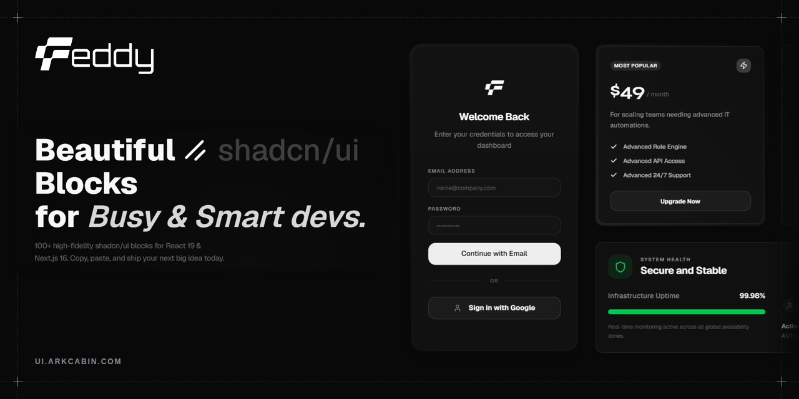

<div align="center">



# Freddy UI

**Premium, copy-paste shadcn/ui blocks for modern web apps.**

100+ production-ready blocks for React 19, Next.js 16 and Tailwind CSS 4, with a clean, true-flat look.

[](https://github.com/arkcabin/freddy-ui/stargazers)
[](https://github.com/arkcabin/freddy-ui/releases)
[](./LICENSE)
[](https://x.com/arkcabin)

[Website](https://ui.arkcabin.com) · [Blocks](https://ui.arkcabin.com/blocks) · [Changelog](https://ui.arkcabin.com/changelog) · [Report a bug](https://github.com/arkcabin/freddy-ui/issues)

</div>

---

## Table of contents

- [Overview](#overview)
- [Features](#features)
- [Tech stack](#tech-stack)
- [Quick start](#quick-start)
- [Using a block in your project](#using-a-block-in-your-project)
- [Project structure](#project-structure)
- [Scripts](#scripts)
- [Adding a new block](#adding-a-new-block)
- [Releases and changelog](#releases-and-changelog)
- [Contributing](#contributing)
- [Contributors](#contributors)
- [License](#license)

## Overview

Freddy UI is a library of beautifully crafted blocks (auth, hero, pricing, footers, forms and more) built on top of [shadcn/ui](https://ui.shadcn.com/). Every block is distributed through a shadcn-compatible registry, so you copy the code into your project and own it. No runtime dependency on Freddy UI.

## Features

- **100+ blocks** across auth, announcement, contact, CTA, FAQs, features, footers, forms, headers, pricing, testimonials and more
- **shadcn registry**: install any block with one CLI command
- **Modern visuals**: double-bezel cards, WebGL backgrounds (light rays, animated gradients), fluid motion
- **Dark and light themes** out of the box
- **Accessible**: built on Radix UI primitives and WAI-ARIA patterns
- **Responsive**: mobile-first layouts
- **TypeScript first**, linted and formatted with [Biome](https://biomejs.dev/)
- **Automated releases**: Conventional Commits drive versioning, GitHub Releases and the on-site changelog

## Tech stack

| Area | Tools |
| --- | --- |
| Framework | Next.js 16 (App Router, Turbopack), React 19 |
| Styling | Tailwind CSS 4, shadcn/ui, Radix UI |
| Motion and graphics | Motion, Three.js, WebGL |
| Tooling | Biome, TypeScript, release-please |

## Quick start

**Requirements:** Node.js 20+ and npm (or pnpm, yarn, bun), plus Git.

```bash
# 1. Clone
git clone https://github.com/arkcabin/freddy-ui.git
cd freddy-ui

# 2. Install
npm install

# 3. Configure environment
cp .env.example .env   # then fill in your values

# 4. Run
npm run dev
```

Open [http://localhost:3000](http://localhost:3000).

## Using a block in your project

In any project that already has shadcn/ui set up:

```bash
npx shadcn@latest add https://ui.arkcabin.com/r/auth-14.json
```

Replace `auth-14` with the block you want. Browse the full list at [ui.arkcabin.com/blocks](https://ui.arkcabin.com/blocks). The CLI installs the files and any required dependencies.

## Project structure

```text
freddy-ui/
├── app/                  # Next.js routes (site, blocks gallery, changelog)
├── components/           # Site components and shadcn/ui primitives
│   └── ui/
├── config/               # Site config and generated block metadata
├── lib/                  # Utilities, auth client, data (incl. changelog)
├── registry/blocks/      # Source of every block (auth, hero, pricing, ...)
├── public/r/             # Generated registry JSON served to the shadcn CLI
├── scripts/              # build-registry and sync-changelog
└── .github/workflows/    # Release automation
```

## Scripts

| Command | What it does |
| --- | --- |
| `npm run dev` | Start the dev server (Turbopack) |
| `npm run build` | Generate Prisma client and build for production |
| `npm run start` | Run the production build |
| `npm run lint` | Lint with Biome |
| `npm run format` | Format with Biome |
| `npm run b:r` | Rebuild the block registry (`public/r/*.json`, `config/blocks.ts`) |
| `npm run sync:changelog` | Regenerate `lib/data/changelog-data.tsx` from `CHANGELOG.md` |

## Adding a new block

1. Create a folder in `registry/blocks/<category>/<number>/` with a `page.tsx` and its components.
2. Register it in `registry/blocks/index.ts`. Order in this file controls display order, so keep numbering sequential.
3. Rebuild the registry:
   ```bash
   npm run b:r
   ```
4. Check quality before opening a PR:
   ```bash
   npm run lint
   ```

Use the shared logo from `@/components/logo` for branding in blocks.

## Releases and changelog

Releases are fully automated with [release-please](https://github.com/googleapis/release-please):

1. Merge PRs into `main` using [Conventional Commits](https://www.conventionalcommits.org/).
2. release-please opens or updates a release PR with the new version and `CHANGELOG.md` entries.
3. When that PR is merged, it tags the release and publishes a GitHub Release.
4. A follow-up step runs `sync-changelog`, which updates the on-site [`/changelog`](https://ui.arkcabin.com/changelog) page, then commits it back to `main`.

| Commit prefix | Version bump |
| --- | --- |
| `fix:` | patch (`0.1.0` → `0.1.1`) |
| `feat:` | minor (`0.1.0` → `0.2.0`) |
| `feat!:` or `BREAKING CHANGE:` | major |
| `chore:`, `docs:`, `refactor:`, `perf:` | listed in the changelog, no required bump |

To credit people on a release, add a `### Contributors` section in `CHANGELOG.md` using GitHub handles:

```md
### Contributors

* @arkcabin (Ark Cabin)
```

Avatars and profile links are generated automatically.

## Contributing

Contributions are welcome.

1. Fork the repo and create a branch: `git checkout -b feat/my-block`
2. Make your changes and run `npm run lint`
3. Commit with a Conventional Commit message: `git commit -m "feat(auth): add passkey block"`
4. Push and open a Pull Request

Guidelines:

- Follow the existing code style (Biome enforces it)
- Keep components typed, accessible and responsive
- Do not introduce new dependencies without a good reason

## Contributors

Thanks to everyone who has helped build Freddy UI.

<a href="https://github.com/arkcabin/freddy-ui/graphs/contributors">
  
</a>

See the full list on the [contributors graph](https://github.com/arkcabin/freddy-ui/graphs/contributors), and per-release credits in the [changelog](https://ui.arkcabin.com/changelog).

## License

Released under the [MIT License](./LICENSE).

## Credits

Inspired by the open-source community, especially [shadcn/ui](https://ui.shadcn.com/), [Tailark](https://tailark.com/) and [Spell UI](https://spell.sh/).

<div align="center">

Built by [@arkcabin](https://x.com/arkcabin). If Freddy UI helps you, consider giving it a ⭐

</div>